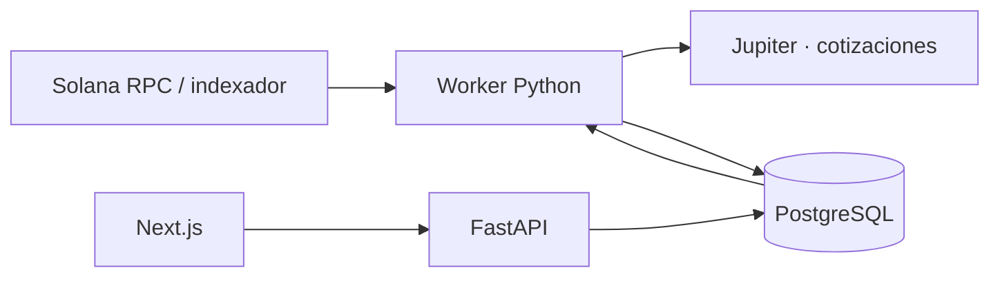
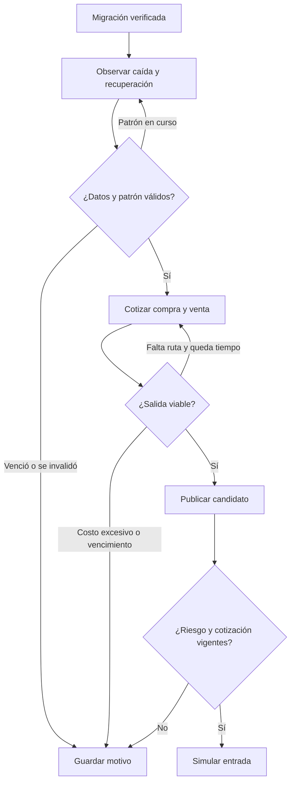

# Arquitectura del radar de memecoins en Solana

Documento de implementación que complementa el README funcional. El primer sistema usable detecta migraciones de Pump.fun a PumpSwap, evalúa la primera caída con recuperación, muestra candidatos con evidencia y mide el resultado de las señales con una cartera simulada. Cuando faltan datos o ningún token pasa los filtros, el panel muestra el motivo de **sin entrada**.

## 1. Diseño y procesos

Usá un **backend modular en Python**, con un solo repositorio y una base PostgreSQL. Ejecutá la API y el worker como procesos separados construidos desde la misma imagen. Next.js consume la API. Docker Compose levanta los servicios y aplica las migraciones antes de iniciar los procesos que dependen del esquema.



| Servicio de Compose | Responsabilidad | Arranque |
|---|---|---|
| `db` | Esquema PostgreSQL, volumen persistente y disponibilidad de consultas. | Primero, con healthcheck. |
| `migrate` | Ejecutar `alembic upgrade head`. | Después de que la base esté disponible. Finaliza al aplicar el esquema. |
| `worker` | Ingesta, actualización de pools, evaluación de estrategias, simulación y conciliación. | Después de las migraciones. |
| `api` | Ranking, detalle, resultados simulados y salud del sistema. | Después de las migraciones. |
| `web` | Interfaz Next.js. | Con la URL de FastAPI configurada. |

El worker usa PostgreSQL como respaldo de los trabajos pendientes, con reintentos y vencimientos persistidos. Para el MVP alcanza un worker. El reclamo de trabajos y los límites de sesión quedan protegidos en la base para admitir reinicios y concurrencia.

## 2. Estructura del repositorio

```text
radar-solana/
  backend/
    app/
      domain/
        strategy.py          # Patrón, filtros y puntaje
        risk.py              # Exposición, límites y capital disponible
        simulation.py        # Reglas de ejecución estimada y de salida
      application/
        ingest_migrations.py # Validación y reconciliación
        evaluate_pool.py     # Snapshots, filtros, cotizaciones y ranking
        process_position.py  # Apertura, valoración y cierre simulado
        ports.py             # Contratos para fuentes y persistencia
      infrastructure/
        solana_rpc.py
        jupiter_quotes.py
        repositories.py
        db.py
        jobs.py
      api/
        main.py
        routes/
        schemas.py
      worker.py
      settings.py
    migrations/
    tests/
      fixtures/
      unit/
      integration/
    Dockerfile
    pyproject.toml
  frontend/
    app/
      page.tsx
      tokens/[mint]/page.tsx
      simulation/page.tsx
    lib/api.ts
    Dockerfile
    package.json
  compose.yaml
  .env.example
  README.md
  ARQUITECTURA.md
```

**Sentido de las dependencias.** El dominio usa tipos y funciones de Python. Aplicación coordina los casos de uso mediante los contratos de `ports.py`. Infraestructura adapta RPC, cotizaciones y PostgreSQL. La API y el worker invocan los casos de uso. Los cálculos de estrategia pueden reproducirse con fixtures y un reloj controlado.

## 3. Contratos y flujo de datos

| Módulo | Entrada → salida | Cuándo corre |
|---|---|---|
| Ingesta de migraciones | Evento RPC → migración verificada con firma, índice de instrucción, slot, mint y pool. | Al llegar un evento y al recuperar un tramo después de una desconexión. |
| Monitor de pools | Pool activo → snapshot con reservas, liquidez, swaps, compradores netos, concentración y frescura por fuente. | Mientras el pool está dentro de la ventana de estrategia y mientras haya una posición que observar. |
| Motor de estrategia | Snapshots disponibles en el instante de evaluación + configuración versionada → estado del patrón, filtros, métricas y motivos. | Con cada ventana cerrada nueva. |
| Adaptador de cotizaciones | Mints, tamaño en unidades base y contexto → ruta, entrada, salida, costos, impacto, vigencia y resultado de la consulta. | Cuando el patrón pasa los filtros previos y al intentar simular una ejecución. |
| Simulación y riesgo | Señal, cotización posterior y sesión → intento, posición, asiento de capital o motivo de rechazo. | Al llegar el instante simulado de entrada y cuando se dispara una salida. |
| API de lectura | Datos persistidos → ranking, evidencia, estado de fuentes y PnL. | A pedido del panel. |

### Ciclo de un candidato



1. **Identidad.** Validá el programa y la relación mint–pool contra el evento. Una migración se identifica por firma e índice de instrucción. Los símbolos y nombres son metadatos.
2. **Tiempo.** Guardá `event_at`, `observed_at` y `evaluated_at` en UTC. El tiempo de evento ordena el mercado y el de observación determina qué información tenía el sistema al emitir la señal. La simulación histórica usa únicamente observaciones disponibles hasta el instante reproducido.
3. **Recuperación.** La estrategia mantiene el máximo inicial y el mínimo observado. Confirma el rebote tras una ventana cerrada. Los valores usados y las referencias a los snapshots quedan congelados en la evaluación.
4. **Cotización y ranking.** Cotizá la venta con la cantidad mínima que podría acreditar la compra según la tolerancia configurada, y conservá la ruta y los costos de ambos lados. Aplicá los filtros obligatorios y ordená los elegibles con los pesos iniciales del README: recuperación 40%, liquidez 30%, costo 20% y holders 10%. Los pesos y umbrales quedan versionados.
5. **Ejecución estimada.** Volvé a consultar después del retraso simulado. Si cambió el precio, la cantidad o la viabilidad, registrá la cotización nueva y la decisión. Una venta fallida deja la posición abierta y crea un intento de salida pendiente según la política configurada.

## 4. Modelo de datos

| Tabla | Clave y relaciones | Campos esenciales |
|---|---|---|
| `tokens` | `mint` | Decimales, símbolo, metadatos observados. |
| `pools` | `address`, FK a `tokens` | Programa, activo de referencia, slot de migración. |
| `chain_events` | Único por `signature, instruction_index, event_index` | Pool, slot, hashes o referencia de evidencia, timestamps. |
| `source_checkpoints` | `source, stream` | Último cursor reconciliado y último instante sano. |
| `market_snapshots` | `id`, FK a pool | Ventana, reservas, flujo, concentración, cobertura y frescura. |
| `quotes` | `id` | Mints, montos en unidades base, ruta, costos, observado y vencimiento. |
| `strategy_versions` | `id` | Configuración inmutable y fecha de activación. |
| `evaluations` | Único por pool, ventana y versión | Snapshot, estado, motivos, puntaje y referencias de cotización. |
| `signals` | `id`, evaluación única | Fecha de emisión, vencimiento, cantidad y nivel de invalidación. |
| `paper_sessions` | `id` | Política evaluada, capital, límites, pausa y fecha de inicio UTC. |
| `paper_positions` | Único por sesión y señal | Estado, cantidades, costo, timestamps y último valor recuperable. |
| `paper_attempts` | `id`, FK a posición | Tipo de intento, número, cotización, resultado y causa de fallo. |
| `paper_ledger` | `id`, referencia única al intento aplicado | Reserva, liberación, débito, crédito y monto. |
| `jobs` | `id`, clave de idempotencia única | Tipo, disponibilidad, vencimiento de reclamo, intentos y último error. |

**Tipos e índices.** Usá `TIMESTAMPTZ` para tiempos, `NUMERIC` con escala cero para unidades base de tokens y decimales de precisión fija para precios. En JSON enviá los enteros grandes como cadenas. Indexá snapshots por pool y ventana, señales por estado y vencimiento, posiciones por sesión y estado, y trabajos por estado y disponibilidad.

**Atomicidad.** Actualizá el checkpoint de ingesta en la misma transacción que los eventos recuperados. Al abrir una posición, bloqueá la fila de la sesión, revalidá el presupuesto y persistí reserva y posición juntas. Protegé cada aplicación de un intento con una clave única. Liberá la reserva si la entrada falla o vence. Las llamadas de red se hacen fuera de las transacciones, con revalidación de vigencia al escribir.

## 5. API y pantallas

| Método y ruta | Contrato de salida | Pantalla |
|---|---|---|
| `GET /api/v1/candidates?status=eligible&limit=25` | Lista paginada, `as_of`, versión y estado general. Cada fila incluye mint, pool, puntaje, liquidez, costo de ida y vuelta, estado y motivos. | Inicio. Ranking y filtros. |
| `GET /api/v1/tokens/{mint}` | Pools, serie de snapshots, cotizaciones y evidencia de la última evaluación por pool. | Detalle. Gráfico, concentración y explicación de la señal. |
| `GET /api/v1/paper-trades?session_id=…` | Posiciones, intentos, montos, costos, PnL y estado de salida. | Simulación. Operaciones abiertas y cerradas. |
| `GET /api/v1/metrics?session_id=…` | PnL realizado, valoración abierta, expectativa, drawdown y comparación con la política por liquidez. | Simulación. Resultados y comparación. |
| `GET /health/live` y `GET /health/ready` | Vida del proceso y preparación, con salud de base, último checkpoint y fuentes degradadas. | Indicador de estado del panel. |

Estados de candidato propuestos: `observing`, `pending_data`, `eligible`, `rejected`, `expired`. Usá códigos de motivo estables, por ejemplo `NO_SELL_ROUTE`, `STALE_MARKET_DATA` y `SESSION_LIMIT`. Mostrá el último instante de actualización incluso cuando el ranking esté vacío. Para el primer corte, actualizá el panel con polling configurable.

## 6. Seguridad y operación

- **Solo lectura on-chain.** El worker consume eventos públicos y cotizaciones. El simulador registra créditos y débitos internos. Las credenciales de proveedor quedan en backend y se inyectan como secretos de entorno.
- **Datos externos.** Validá mints, respuestas de proveedores y esquemas. Escapá nombres y símbolos. Si mostrás logos, restringí orígenes de imágenes y evitá resolver URLs arbitrarias de tokens desde el servidor.
- **Fallas y recuperación.** Reintentá errores transitorios con espera creciente. Si se corta el WebSocket, completá el tramo perdido desde el cursor persistido y deduplicá. Al quedar una fuente fuera de vigencia, bloqueá nuevas entradas vinculadas a ella y mantené el seguimiento de posiciones.
- **Exposición del panel.** En local, limitá el acceso al equipo de desarrollo. Si lo publicás, agregá autenticación, control de origen y límites de consultas. Los logs evitan credenciales y URLs RPC sensibles.
- **Observabilidad.** Medí retraso de ingesta, snapshots caducados, trabajos reintentados, fallas de cotización, candidatos descartados por motivo, intentos de salida y capital reservado. La pausa de simulación se persiste para sobrevivir un reinicio.
- **Configuración inicial.** Prepará `.env.example` con `DATABASE_URL`, `SOLANA_RPC_URL`, `SOLANA_WS_URL`, `JUPITER_API_KEY`, `DATA_MODE` y la URL interna de la API para Next.js. Cada versión de estrategia fija ventanas, umbrales, montos, costos máximos y caducidad.

## 7. Orden de construcción y prueba

| Etapa | Implementá | Criterio de aceptación |
|---|---|---|
| 1. Corte vertical con fixtures | Compose, Alembic, una migración grabada, snapshots, una evaluación y ranking web. | Un fixture pasa de migración a candidato visible. Ejecutarlo dos veces conserva una sola evaluación para cada ventana. |
| 2. Ingesta real | Solana RPC, verificación de pool, checkpoints y reconciliación. | La migración se detecta y se recupera tras una desconexión sin duplicados. |
| 3. Estrategia | Reglas, razón de rechazo, score versionado y vencimiento. | Casos de prueba cubren rebote válido, rebote sin volumen y datos incompletos. |
| 4. Cotizaciones y simulador | Compra y venta estimadas, retrasos, presupuesto y salida fallida. | Un error preserva la posición abierta y dos workers no abren dos veces la misma señal. |
| 5. Evaluación | Sesiones separadas para ranking y referencia por liquidez, con condiciones equivalentes. | Comparación de PnL neto en SOL y USD, incluyendo operaciones sin salida, costos y caída máxima. |

Cuando estén creados los archivos y servicios del proyecto, el arranque local previsto es `docker compose up --build`. Comenzá con `DATA_MODE=fixtures`. Después activá el modo en vivo con credenciales del proveedor y confirmá el estado de fuentes antes de evaluar señales.

**Entrega del MVP.** Desde el panel se puede abrir un token, identificar el pool y la transacción de migración, ver por qué pasó o falló cada filtro y seguir su posición simulada hasta el resultado. El ranking queda listo para evaluarse con datos nuevos y reglas congeladas frente a la referencia por liquidez.

## Referencias de integración

- [Solana RPC](https://solana.com/docs/rpc)
- [Documentación pública de Pump.fun](https://github.com/pump-fun/pump-public-docs)
- [Jupiter Swap API](https://developers.jup.ag/docs/swap)
