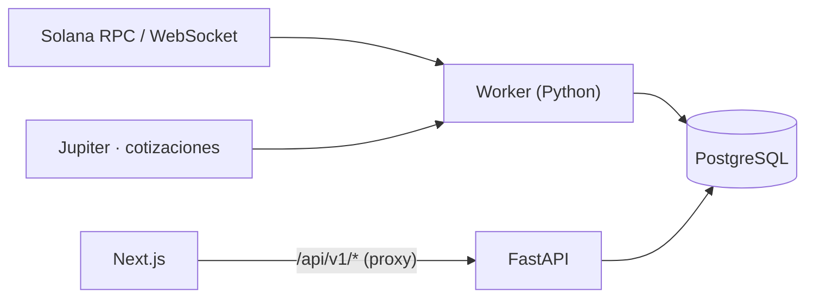

# Radar de memecoins recién migradas en Solana

Detecta migraciones de **Pump.fun → PumpSwap**, evalúa la *primera caída con recuperación*, muestra candidatos con su evidencia y mide el resultado de las señales con una **cartera simulada**. Sin candidatos o sin presupuesto, el panel dice **sin entrada** y explica por qué.

- Especificación funcional: [CONTENIDO.md](CONTENIDO.md) · Arquitectura: [ARQUITECTURA.md](ARQUITECTURA.md)
- **Solo lectura on-chain.** Ningún componente firma ni envía transacciones. Las operaciones son asientos internos del simulador.
- Los resultados simulados **no son evidencia de rentabilidad**. El modo `fixtures` usa datos sintéticos y los umbrales no están calibrados con datos reales.



## Arranque rápido

### Con Docker (recomendado)

```powershell
copy .env.example .env      # cambiá POSTGRES_PASSWORD; el resto sirve para fixtures
docker compose up --build
```

Abrí <http://localhost:3000>. Orden de arranque: `db` (healthcheck) → `migrate` (`alembic upgrade head`) → `worker` y `api` → `web`. En modo `fixtures` el worker reproduce 15 escenarios en ~2 minutos: verás candidatos elegibles aparecer, entradas simuladas, salidas por objetivo/invalidación, reintentos de ventas fallidas y una posición ilíquida. Documentación interactiva de la API: <http://localhost:8000/docs>.

### Sin Docker (PowerShell, SQLite)

```powershell
cd backend
py -3.11 -m venv .venv; .\.venv\Scripts\Activate.ps1
pip install -e ".[dev]"
$env:DATABASE_URL = "sqlite:///radar.db"
python -m app.cli migrate        # aplica Alembic
python -m app.cli replay         # reproduce todos los escenarios sin esperas y resume el resultado
python -m app.worker             # terminal 2: mantiene vivo el worker
python -m uvicorn app.api.main:app --port 8000   # terminal 3 (con el mismo DATABASE_URL)

cd ..\frontend                   # terminal 4
npm install
$env:API_INTERNAL_URL = "http://127.0.0.1:8000"
npm run dev                      # http://localhost:3000
```

### Pruebas

```powershell
cd backend
pytest                      # todo (146 pruebas)
pytest tests/unit           # dominio y adaptadores, sin base de datos
pytest tests/postgres       # PostgreSQL real: pip install ".[pgtest]" o TEST_DATABASE_URL=postgresql+psycopg://...
cd ..\frontend; npm run typecheck
```

## Modos de datos

| `DATA_MODE` | Fuente | Para qué |
|---|---|---|
| `fixtures` (por defecto) | Escenarios JSON deterministas de `backend/fixtures/scenarios`, reloj de reproducción persistido | Desarrollo, demos y pruebas reproducibles |
| `live` | Solana RPC + WebSocket, PumpSwap y Jupiter Swap v2 (`GET /order`, solo cotización) | Observación real. Requiere `SOLANA_RPC_URL` y, para más cupo, `JUPITER_API_KEY` |

Antes de evaluar señales en vivo, mirá el indicador de estado del panel: una fuente degradada (sin lecturas sanas o con fallas seguidas) **bloquea nuevas entradas** pero mantiene el seguimiento de posiciones abiertas.

## Cómo decide el sistema

1. **Ingesta.** Se detecta la instrucción `migrate` de Pump.fun, se valida programa, mint y pool contra la cuenta real en PumpSwap y se guarda con firma, índice de instrucción, slot y los tres instantes (`event_at`, `observed_at`, `evaluated_at`). El checkpoint avanza en la misma transacción que los eventos.
2. **Patrón.** Máximo inicial en una ventana configurable → caída entre un mínimo y un máximo admisibles → recuperación confirmada con ventanas cerradas consecutivas. Al confirmar, máximo, mínimo y nivel de invalidación **quedan congelados**: ventanas futuras no reescriben la señal.
3. **Filtros obligatorios** (cada uno deja motivo, valor y umbral): migración verificada, identidad mint–pool, edad, datos frescos, concentración evaluable y aceptable, patrón confirmado, compradores netos, profundidad, estabilidad de liquidez, ruta de compra y venta, cotización vigente y costo de ida y vuelta.
4. **Puntaje** 0–100 sin redondear: recuperación 40 % · liquidez 30 % · costo 20 % · holders 10 %, con rangos fijos por versión (no depende de otros candidatos). Desempate por costo y por frescura de la cotización.
5. **Simulación.** Reserva de capital al admitir la señal → entrada con cotización nueva tras el retraso (rechazo registrado si cambió precio, ruta o costo) → valoración conservadora → salida por invalidación, deterioro de liquidez, objetivo o tiempo máximo. Una venta fallida **deja la posición abierta**, registra la causa y reintenta con más tolerancia de slippage; una posición sin ruta se muestra aparte con escenario de recuperación cero.
6. **Evaluación.** Dos sesiones con el mismo universo, presupuesto, retrasos y reglas: *ranking por puntaje* contra *referencia por liquidez*. PnL neto en SOL y USD, expectativa, tasa de acierto, caída máxima, PnL sin la mejor operación, escenario adverso, posiciones con salida fallida y bloque cronológico (`since`/`until`).

Estados de candidato: `observing`, `pending_data`, `eligible`, `rejected`, `expired`. Los códigos de motivo (`NO_SELL_ROUTE`, `STALE_MARKET_DATA`, `SESSION_LIMIT`, …) son estables y están en [reasons.py](backend/app/domain/reasons.py).

### Configuración versionada

Cada versión fija ventanas, umbrales, montos, costos máximos, caducidades y pesos ([config.py](backend/app/domain/config.py)). Es **inmutable**: reutilizar un nombre con otro contenido falla; para cambiar umbrales creá un archivo nuevo (p. ej. `backend/config/mi-estrategia-v2.json`) y apuntá `STRATEGY_CONFIG_PATH`. Los valores de [strategy-fixtures-v1.json](backend/config/strategy-fixtures-v1.json) son de fixtures: calibrá con observaciones reales y congelalos antes de la evaluación fuera de muestra.

## API

| Ruta | Contenido |
|---|---|
| `GET /api/v1/candidates?status=eligible&limit=25` | Ranking paginado, `as_of`, versión y `no_entry` con motivos cuando no hay elegibles |
| `GET /api/v1/tokens/{mint}` | Pools, serie de snapshots, cotizaciones y evidencia de la última evaluación |
| `GET /api/v1/paper-trades?session_id=` | Posiciones, intentos, costos, PnL y estado de salida |
| `GET /api/v1/metrics?session_id=&since=&until=` | Métricas y comparación con la referencia por liquidez |
| `GET /api/v1/signals`, `/sessions`, `/ops`, `/status` | Señales para depurar, sesiones, indicadores operativos, estado de fuentes |
| `GET /api/v1/export/{paper-trades,candidates}.csv` | Exportaciones (protegidas contra inyección de fórmulas) |
| `POST /api/v1/sessions/{id}/pause\|resume` | Pausa/reanuda nuevas entradas; exige `X-Admin-Token` |
| `GET /health/live`, `/health/ready` | Vida del proceso; preparación (base, latido del worker, fuentes degradadas) |

Los lamports y unidades base viajan como **cadenas** (sin pérdida de precisión en JSON).

## Seguridad y operación

- Claves RPC/Jupiter solo en el servidor; los logs redactan claves y credenciales en URLs. El navegador solo habla con `/api/v1/*` del panel (proxy que valida rutas y solo reenvía `GET`, más pausa/reanudación si `PANEL_CONTROLS=true`; el token de administración se agrega en el servidor).
- Puertos publicados solo en `127.0.0.1` (panel 3000, API 8000). **La base no se publica**: la alcanzan la API y el worker por la red interna. Para usar `psql` o un cliente gráfico: `docker compose -f compose.yaml -f compose.db-port.yaml up` (puerto 55432, para no chocar con un PostgreSQL instalado en Windows). **Si exponés el panel a internet**, ponele autenticación delante (proxy inverso con login), restringí `CORS_ORIGINS` y revisá `RATE_LIMIT_PER_MINUTE`.
- Datos externos (nombres, símbolos) se sanean en la API y React los escapa; el panel no carga imágenes ni URLs de tokens y la CSP bloquea orígenes de terceros.
- Reintentos con espera creciente, trabajos con reclamo vencible (`FOR UPDATE SKIP LOCKED`) y pausa persistida: sobreviven reinicios. Escalado en vivo: `docker compose up --scale worker=2`. En `fixtures` dejá un solo worker.
- Operación: `GET /api/v1/ops` expone retraso de ingesta, snapshots vencidos, trabajos reintentados, fallas de cotización, descartes por motivo, intentos de salida y capital reservado. Auditoría de cambios de estado en la tabla `audit_log`.

## Casos de aceptación ↔ pruebas

| Caso (CONTENIDO.md §7) | Prueba |
|---|---|
| Migración real → candidato visible; dos reprocesamientos, una evaluación por ventana | `test_replay_pipeline::TestIdempotency` |
| Desconexión y recuperación sin duplicados | `test_live_adapters::TestMigrationSource` (cursor, orden, huecos) + `TestIdempotency::test_one_migration_reprocessed…` |
| Cotización vencida | `test_strategy::test_stale_quote_is_pending`, `test_risk_simulation::test_expired_signal_stale_quote…` |
| Ausencia de ruta de venta | `test_strategy::test_no_sell_route_is_pending…`, `TestFullReplay` (ZETA) |
| Concentración desconocida | `test_strategy::test_unknown_concentration…`, `test_live_adapters` (propietario sin resolver) |
| Saltos de precio | `test_risk_simulation::test_price_jump…`, `TestFullReplay::test_price_jump…` (IOTA) |
| Venta fallida mantiene la posición abierta | `TestFullReplay` (THET, OMIC, KAPA) |
| Límites simultáneos con dos workers | `tests/postgres::test_two_workers_never_open_the_same_signal_twice` |
| Rebote sin volumen, datos incompletos | `test_strategy::TestEvaluate` |

## Estructura

```text
backend/app/domain/          estrategia, riesgo, costos, simulación, métricas (puro, sin I/O)
backend/app/application/     casos de uso y contratos (ports.py)
backend/app/infrastructure/  PostgreSQL/SQLAlchemy, RPC de Solana, Jupiter, fixtures, jobs
backend/app/api/             FastAPI        backend/app/worker.py   ciclo del worker
backend/migrations/          Alembic        backend/fixtures/       escenarios sintéticos
backend/tests/               unit · integration · postgres
frontend/                    Next.js (ranking, detalle de token, simulación)
compose.yaml  .env.example
```

## Verificación realizada y límites conocidos

**Verificado en este entorno**
- 146 pruebas automáticas: reglas de dominio, flujo completo con fixtures (migración → señal → posición → PnL), API, migraciones (`upgrade`, `check` sin diferencias y `downgrade`) y **PostgreSQL real** (tipos `NUMERIC(40,0)`/`JSONB`, enteros u64 exactos, cuatro workers compitiendo por las mismas señales, reclamos con `SKIP LOCKED`).
- Frontend: chequeo de tipos, build de producción y revisión visual con capturas (tema oscuro, claro y 500 px de ancho).
- **`docker compose up --build` en Windows con Docker 26:** las imágenes se construyen, `migrate` aplica Alembic sobre PostgreSQL 16, y `db`, `api` y `web` quedan `healthy`. La reproducción de fixtures sobre ese PostgreSQL dio el mismo resultado exacto que las pruebas con SQLite.

**No verificado (decílo antes de confiar en ello)**
- **El modo `live` contra Solana y Jupiter reales.** Los adaptadores se probaron con respuestas sintéticas y transportes HTTP simulados, siguiendo el IDL público de Pump.fun/PumpSwap y la documentación de Jupiter. Hacé una prueba de humo con tu RPC antes de usarlo. Puntos a confirmar: la cuenta de migración por defecto (`PUMP_MIGRATION_ACCOUNT`, con la que se consulta en vez de todo el programa); el mapa de cuentas de `migrate_v2`, que se deduce del `create_pool` interno y, si no coincide, **falla cerrado** (el pool queda sin verificar y no se evalúa); y los campos de respuesta de `/order`. La verificación de identidad usa la cuenta real del pool, no solo la derivación de PDA.
- Rendimiento con tráfico real (muchos pools simultáneos): la lectura de swaps hace una llamada RPC por transacción nueva, con tope por ciclo.

## Decisiones que complementan los documentos

- Se guarda una evaluación por pool, ventana y versión, siempre sobre la **última** ventana cerrada. Si cierran varias entre dos ciclos solo se evalúa la última (no se puede cotizar en un instante pasado), pero el patrón reproduce todas las ventanas. Vencimientos que dependen del tiempo (edad máxima, señal vencida, datos obsoletos) se resuelven al leer, sin reescribir evaluaciones guardadas.
- Compradores netos con confirmación de varias ventanas: se usa el máximo por ventana (cota inferior de wallets distintas).
- Los depósitos de cuentas de token (reembolsables) se registran por separado y no cuentan como costo; sí cuentan como fondos inmovilizados (y como recuperación cero en posiciones ilíquidas).
- Las cotizaciones de valoración de posiciones abiertas no se persisten salvo que fallen (evidencia de fallas); las de evaluación, entrada y salida sí.
- Las salidas fallidas se reintentan sin tope de intentos, con tolerancia de slippage creciente hasta un máximo; tras `exit_retry_max` fallos la posición se marca ilíquida.
- Actualización del panel por *polling* configurable (`POLL_SECONDS`), como pide la arquitectura para el primer corte.
